# An Introduction to VSWIR Imaging Spectroscopy use in Mineral Mapping

Southern Pine Valley area, southern Wah Wah Range, Beaver County, Utah (Utah Geological Survey AOI)

ORNL DAAC Demonstration Tutorial (by Michele Thornton)

Critical Minerals Imaging Workshop, September 29, 2026, Salt Lake City, UT

## Background

VSWIR (Visible to Short-Wave Infrared) mineral mapping is a remote sensing technique used to identify and map minerals on a planet’s surface based on how sunlight is reflected and absorbed. Minerals absorb specific wavelengths of light based on their atomic structures, chemical bonds, and ionic radii. VSWIR excels at identifying minerals containing **hydroxyls (OH), water (H2O), carbonates (e.g. calcite, dolomite), and sulfates (e.g. alunite, gypsum)**.

VSWIR mapping typically spans wavelengths from 400 nm – 2500 nm typically broken into subregions:

> **Visible (VNIR, ~400 – 700 nm):** effective for detecting iron oxides, oxyhydroxides (hematite and goethite), and rare earth mineral
>
> **Near-Infrared (NIR, ~700 – 1100 nm):** captures specific electronic interactions and early vibration behaviors
>
> **Short-Wave Infrared (SWIR, ~1100 – 2500 nm):** the ***“sweet spot”*** for mineralogy. Detects molecular bond vibrations within crystal lattices.

Minerals are identified by:

> **Absorption Features**: distinct “troughs” or dips in a spectral graph
>
> **Wavelength Shifts**: Minor chemical substitutions in a mineral (e.g. Mg replacing Fe) will slightly shift the position of troughs on the spectral graph giving precision to mineral composition and crystallinity levels.

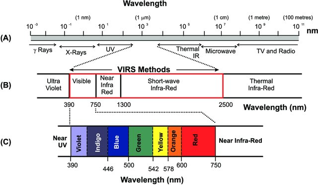

The electromagnetic spectrum, showing the context of visible/infrared reflectance spectroscopy. Namely the ***visible region (390 to 750 nm)***, the ***near infrared (NIR; 750 to 1300 nm)*** and the ***short-wave infrared (SWIR, 1300 to 2500 nm)*** (Kerr et al. 2011).

### VSWIR Instruments in the GEMx Campaign

Visible-to-shortwave-infrared (VSWIR) imaging spectrometers measure reflected sunlight across many adjacent wavelength bands in the 380 - 2500 nm range.

> [AVIRIS-5](https://www.earthdata.nasa.gov/data/instruments/aviris-5) (Airborne Visible/Infrared Imaging Spectrometer-5) is an advanced high-precision imaging spectrometer developed by NASA's Jet Propulsion Laboratory (JPL) to scan the Earth's surface and atmosphere from high-altitude aircraft. AVIRIS-5 is one of the airborne instruments deployed in the GEMx Campaign.
>
> [EMIT](https://www.earthdata.nasa.gov/data/instruments/emit-imaging-spectrometer) (Earth Surface Mineral Dust Source Investigation) is an imaging spectrometer NASA Earth Venture Instrument (EVI-4) mounted to the exterior of the International Space Station (ISS).

Visible-to-shortwave-infrared (VSWIR, 380 – 2500 nm) imaging spectroscopy can measure the diagnostic molecular absorption features of surface minerals. Because AVIRIS and EMIT resolve the full VSWIR at high spectral fidelity, they can measure the position and width of this feature.

| **Scale**  | **Sensor** | **Pixel**                    | **Role in this tutorial**                                                                                                                                                                          |
|------------|------------|------------------------------|----------------------------------------------------------------------------------------------------------------------------------------------------------------------------------------------------|
| Airborne   | AVIRIS-5   | ~10 m (workshop flight line) | Image acquisition and mapping in QGIS. Spectral profile AI-OH demonstration. We pull L2A surface reflectance to examine the diagnostic absorption features that drive the mineral identifications. |
| Spaceborne | EMIT (ISS) | ~60 m                        | Regional screening and indicator areas. We use the L2B mineralogy (L2BMIN) product that demonstrates mapping of alunite, white mica, kaolinite, pyrophyllite, dickite over the AOI.                |

### Geologic Study Area

For this exercise, our area of interest is the **Southern Pine Valley** area, southern Wah Wah Range, Beaver County, Utah (Utah Geological Survey AOI). This area of interest (AOI) is defined by the Utah Geological Survey (UGS) in the Southern Pine Valley area of the southern Wah Wah Range, Beaver County, Utah, where the UGS holds associated surface geochemistry data. The area is co-located with the UGS 1:24,000-scale geologic map of the area, Open-File Report 671 (OFR-671).

The Southern Pine Valley sits on the Pioche mineral belt or Blue Ribbon lineamont which consists of Cambian through Devonian carbonates, Oliogocene Needles Range Group ash-flow tufts, and Miocene Blawn Formation rhyolites which contain critical minerals.

## GEMx Data Access Resources

[GEMx NASA Earthdata Project page](https://www.earthdata.nasa.gov/data/projects/gemx): GEMx data are published to NASA Earthdata and are available from the NASA Earthdata GEMx Project Page

> [GEMx DATA PORTAL](https://popo.jpl.nasa.gov/mmgis-aviris/?mission=GEMx): A GEMx Project Visualization of airborne flight tracks (AVIRIS-Classic, AVIRIS-5, and MASTER instruments) with NASA Earthdata data direct download access URL’s..

## Prerequisites 

Software: For this demonstration, we are using the latest LTR of QGIS with the EnMAP-Box 3 plugin.

- [QGIS](https://www.qgis.org/download/) (3.44.13 LTR)

  - [EnMap-Box Plugin](https://enmap-box.readthedocs.io/en/latest/usr_section/usr_installation.html)

    - EnMap Read the docs: [https://enmap-box.readthedocs.io/en/latest/usr_section/usr_manual/speclibs.html](https://enmap-box.readthedocs.io/en/latest/usr_section/usr_manual/speclibs.html)

- An [Earthdata Login](https://urs.earthdata.nasa.gov/) account is required to access data from the NASA Earthdata system.

## Learning Objectives

1.  Understand GEMx AVIRIS-5 data discovery and access including downloading reflectance files for a region of interest.

2.  Open and Visualize AVIRIS-5 reflectance netCDF files in QGIS.

3.  Create mosaic virtual raster layers that retain band to wavelength associations

4.  Understand and visualize AVIRIS-5 Reflectance files in two ways:

    1.  various 3-band combinations that highlight significant mineral characteristics

    2.  using the EnMap plugin, create point-specific spectral profiles of critical mineral areas from areas mapped as spectrally indicative

5.  Understand band combinations and spectral profiles in the context of mineral mapping applications

## QGIS and EnMap-Box Demonstration

### Identify and Download GEMx AVIRIS-5 Reflectance Files 

There are a few ways to access and download AVIRIS-5 data from the GEMx Campaign. For this introductory exercise, we’ll use the JPL GEMx Data Portal to find and download data in an area of interest.

#### Step 1
From the [MMGIS browser for the GEMx Project](https://popo.jpl.nasa.gov/mmgis-aviris/?mission=GEMx), download the AVIRIS-5 Coverage (***AVIRIS-5 Coverage.geojson***) to your local device.

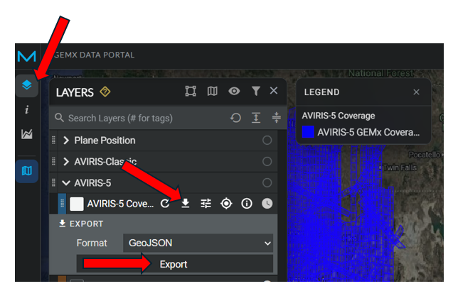

#### Step 2
For an area of interest (AOI) we can download GIS files for the **Southern Pine Valley** from the [Utah Geological Survey Maps Portal](https://geology.utah.gov/map-pub/maps/geologic-maps/).

- Select **Intermediate Scale Index**

- Search **Southern Pine Valley**

- Click on the highlighted box and click on **Download GIS Data** from the popup

- Once downloaded, unzip the ofr-671.zip file

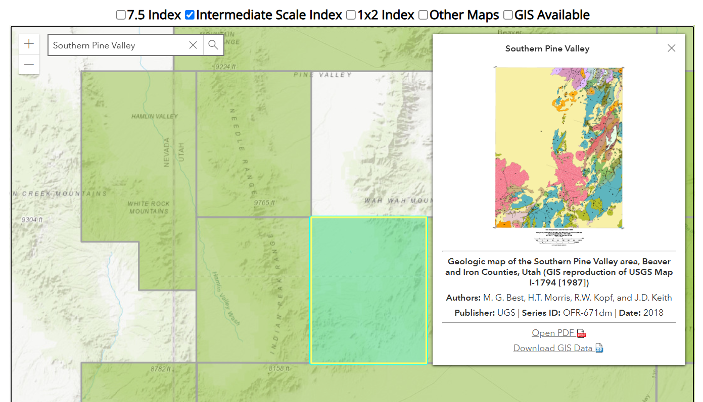

> File content download: **ofr-671.zip**

- OFR-671DM_SouthernPineValleyArea.gdb

- OFR-671DM_SouthernPineValleyArea_Shapefiles

- Geologic Map Attribute Explanation.pdf

- OFR-671DM_SouthernPineValley.tif and .tfw

- OFR-671DM_SouthernPineValley_GeologicUnit_AttributeTable.csv

#### Step 3
Open QGIS and add layers:

- **AVIRIS-5 Coverage** geojson file of flight lines.

- **SouthernPineValleyArea_GeologicUnits** shapefile

> Note there are direct AVIRIS-5 file Earthdata download links attributed in the **AVIRIS-5 Coverage** geojson. These are the same download links that drive the downloads in the MMGIS GEMx Data Portal.
>
> 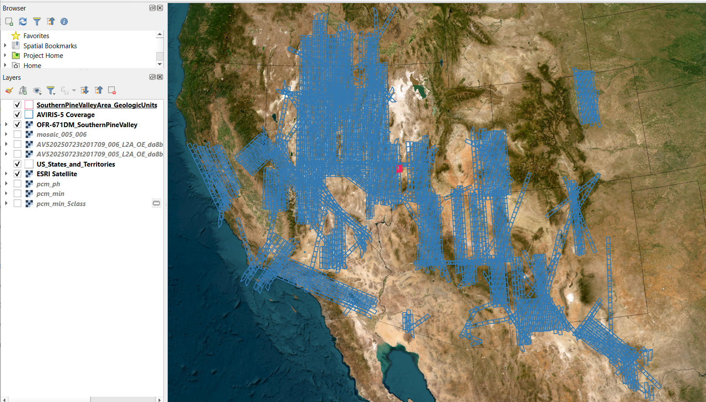

#### Step 4
In QGIS, we can zoom into our area of interest, the Southern Pine Valley, using the GIS files available from the Utah Geologic Society. We can determine which AVIRIS-5 Coverage flight tiles are within our area of interest.

- Right-click on the SouthernPineValleyArea_GeologicUnits.shp file and click **Zoom to Layer**

#### Step 5
We can use the QGIS ***Identify Features*** tool to view attributes of AVIRIS-5 Coverage selected tiles within the area of interest.

- In the Layers Table of Contents, make sure the **AVIRIS-5 Coverage** is selected

- Use the **Identify Features** tool  to select a flight tie of interest

- Examine the attributes within the AVIRIS-5 Coverage for the selected tile

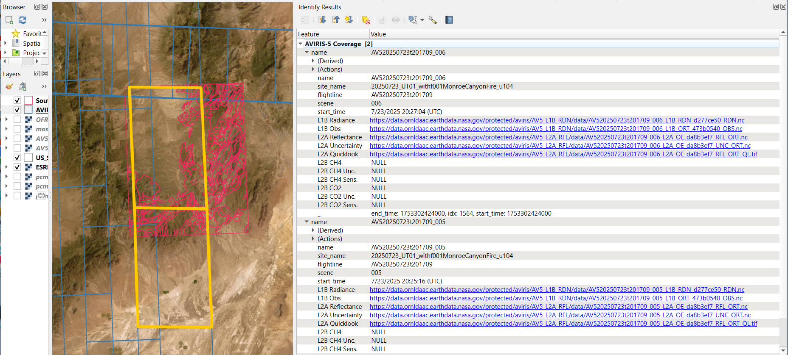

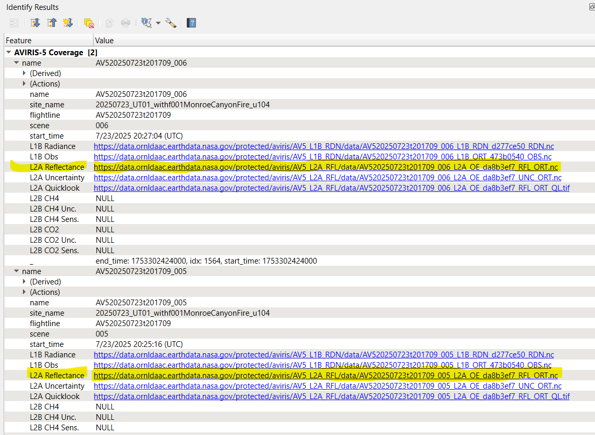

#### Step 6
Clicking on the https URL links of the L2A Reflectance file name will begin a direct download of the reflectance file for the selected flight line tile. Directly download each selected line's reflectance netCDF file

- [AV520250723t201709_005_L2A_OE_da8b3ef7_RFL_ORT.nc](https://data.ornldaac.earthdata.nasa.gov/protected/aviris/AV5_L2A_RFL/data/AV520250723t201709_005_L2A_OE_da8b3ef7_RFL_ORT.nc)

- [AV520250723t201709_006_L2A_OE_da8b3ef7_RFL_ORT.nc](https://data.ornldaac.earthdata.nasa.gov/protected/aviris/AV5_L2A_RFL/data/AV520250723t201709_006_L2A_OE_da8b3ef7_RFL_ORT.nc)

We will need to use our [Earthdata Login](https://urs.earthdata.nasa.gov/) to continue the download.

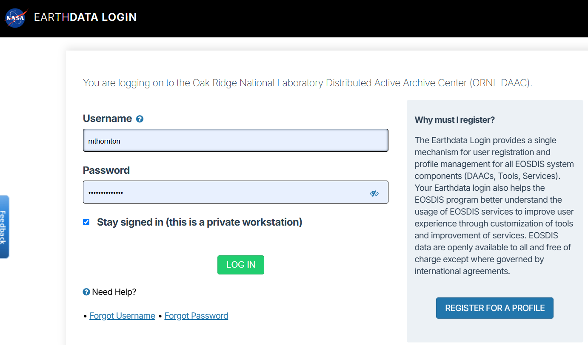

#### Step 7
With the two AVIRIS-5 Reflectance files downloaded, we can add them to QGIS.

> Note: AVIRIS-5 reflectance is a NetCDF datatree: the cube is at **\['reflectance'\]\['reflectance'\]** with easting/northing map coordinates and a wavelength (singular) coordinate. Without diving too deep into the netCDF datatree structure, know that you will need to choose **/reflectance/reflectance** when adding this item.

- Use the **Add Raster Layer** to add the AVIRIS-5 reflectance files in netCDF format.

> **Layer -\> Add Layer -\> Add Raster Layer …**
>
> Select the **reflectance/reflectance** item and click **Add Layers**

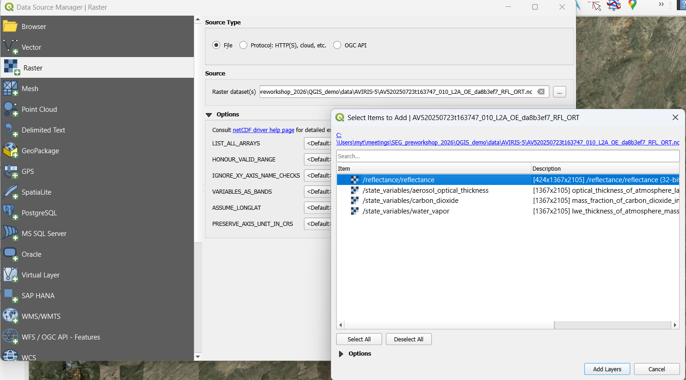

Add both scenes; the netCDF files to the QGIS Layer panel.

- AV520250723t201709_005_L2A_OE_da8b3ef7_RFL_ORT.nc

- AV520250723t201709_006_L2A_OE_da8b3ef7_RFL_ORT.nc

> Note: These two lines are from the same acquisition (same time stamp, consecutive line numbers) and are in the same UTM CRS so they share the wavelength grid and a common easting/northing lattice and tile together seamlessly.

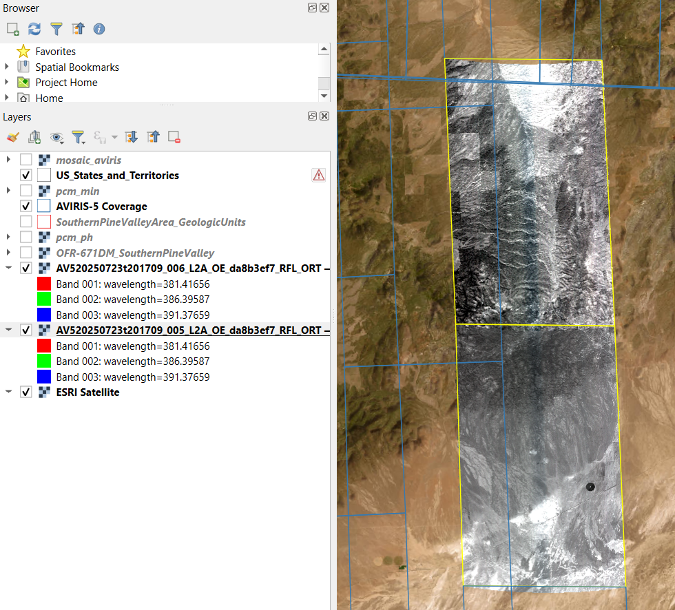

#### Step 8
We can examine the **Properties** of one of the netCDF reflectance files.

In the Layer Table of Content, right click one of the AVIRIS-5 files and select **Properties**

 

Some items to note in the **Information** pane:

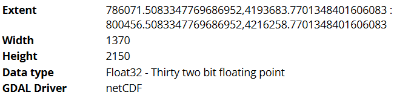

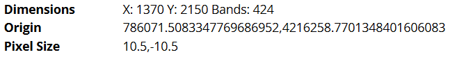

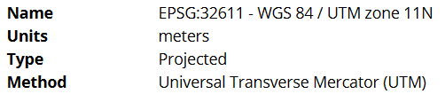

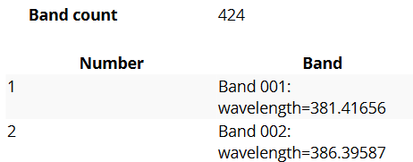


We can create a true color image with the **Symbology** tab.

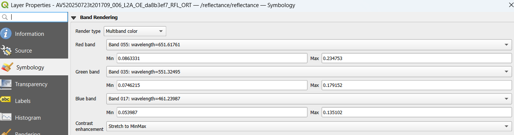

For a true color image, update the Red, Green, and Blue bands:

**True color**
- **Red channel: ~650nm (Band 55)**
- **Green channel: ~550 nm (Band 35)**
- **Blue channel: ~460 nm (Band 17)**

In in the Symbology tab, be sure to stretch the histogram min and max values based on the 2nd and 98th percentiles on **Min/Max Value Settings**:

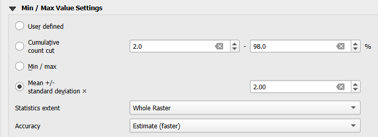

We can see we adjusted the band combinations for one tile, but not the other:

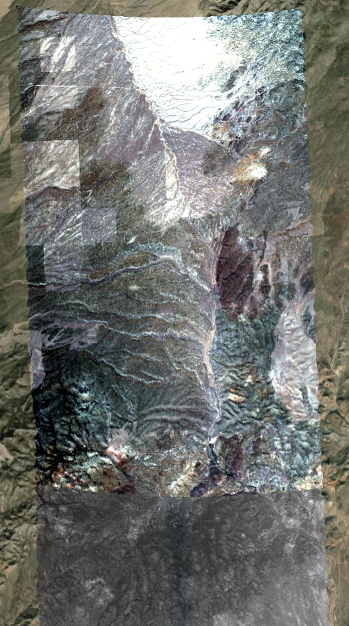

### Create a Virtual mosaic with GDAL

Creating a virtual mosaic of adjacent AVIRIS-5 (Airborne Visible/Infrared Imaging Spectrometer) flight lines is a common preprocessing step in hyperspectral remote sensing. A virtual mosaic stitches adjacent tiles (or tracks) into a single, cohesive spatial scene.

A big advantage of "virtual" mosaics is that they reference the underlying flight line datasets via a metadata framework without copying or generating an entirely new, massive data file. Virtual mosaics save storage space, prevent redundant preprocessing, and lets us apply uniform color correction, analysis, or filtering across all tiles instantly.

**Step 9:** We can create a virtual mosaic within QGIS, but we will use GDAL (Geospatial Data Abstraction Library) in combination with a final python command in order to associate the wavelengths with the band numbers. We will be happy to have wavelengths when we are visualizing data.

The **OSGeo4W Shell** is a pre-configured Windows command prompt (cmd) that automatically loads environment paths for geospatial libraries like GDAL/OGR, GRASS GIS, PROJ, and Python. OSGeo4W Shell is automatically installed with QGIS on Windows, provided you use the official standard installers from the QGIS Website

**1**. Open the **OSGeo4W Shell** (from your PC’s applications - loads with QGIS) and navigate to your working folder.


```
cd /d C:\path_to_your_qgisfiles
```

**2.** Create virtual layers from the 2 AVIRIS-5 netCDF files

```
gdal_translate -of VRT NETCDF:"AV520250723t201709_005_L2A_OE_da8b3ef7_RFL_ORT.nc":/reflectance/reflectance tile_005.vrt
```

```
gdal_translate -of VRT NETCDF:"AV520250723t201709_006_L2A_OE_da8b3ef7_RFL_ORT.nc":/reflectance/reflectance tile_006.vrt
```

**3**. Mosaic the individual vrt’s into a single canvas

```
gdalbuildvrt -resolution highest mosaic_005_006.vrt tile_006.vrt tile_005.vrt
```

**4.** We want to keep the wavelengths associated with the band number which is much more intuitive when creating 3-band visualizations.

GDAL does not know how to work with the netCDF datacube layout, so we present two ways to keep band/wavelength in the virtual mosaic..

1.  In the **OSGeo4W Shell,** run the provided python script **set_vrt_wavelengths.py**

This creates a virtual mosaic called **mosaic_005_006.vrt**

OR

2.  Copy and paste this python script into the OSGeo4W command line and run it by pressing enter.

```
python -c "import xml.etree.ElementTree as ET, os; t = ET.parse('tile_005.vrt').getroot(); w = next(m.text.strip('{}') for m in t.findall('.//MDI') if m.get('key') == 'NETCDF_DIM_wavelength_VALUES'); wl = [x.strip() for x in w.split(',') if x.strip()]; m_tree = ET.parse('mosaic_005_006.vrt'); m_root = m_tree.getroot(); env = ET.SubElement(m_root, 'Metadata', domain='ENVI'); ET.SubElement(env, 'MDI', key='wavelengths').text = '{' + ', '.join(wl) + '}'; ET.SubElement(env, 'MDI', key='wavelength_units').text = 'nm'; [b.find('Metadata').clear() or m or b.append(ET.Element('Metadata')) or m for b in m_root.findall('VRTRasterBand') for m in [b.find('Metadata') or ET.SubElement(b, 'Metadata')] for i in [int(b.get('band'))-1] if i < len(wl) for _ in [ET.SubElement(m, 'MDI', key='wavelength').set('text', wl[i]), getattr(m.find('.//MDI[@key=\wavelength\]'), 'set')('text', wl[i]) if m.find('.//MDI[@key=\wavelength\]') is not None else ET.SubElement(m, 'MDI', key='wavelength').text, setattr(m.find('.//MDI[@key=\wavelength\]') if m.find('.//MDI[@key=\wavelength\]') is not None else ET.SubElement(m, 'MDI', key='wavelength'), 'text', wl[i]), setattr(b.find('Description') if b.find('Description') is not None else ET.SubElement(b, 'Description'), 'text', f'Band {i+1} ({wl[i]} nm)'), ET.SubElement(m, 'MDI', key='wavelength_units').set('text', 'nm')]]; m_tree.write('mosaic_005_006.vrt', encoding='utf-8', xml_declaration=True); os.path.exists('mosaic_005_006.vrt.aux.xml') and os.remove('mosaic_005_006.vrt.aux.xml'); print(f'Successfully refined and injected {len(wl)} wavelengths!')"
```

**5.** Finally, (this takes about 10 minutes to run), building virtual overviews, or pyramids, will make QGIS much faster and more efficient when zooming and panning.

```
gdaladdo -r nearest mosaic_005_006.vrt 2 4 8 16
```

### Visualize the Virtual Mosaic

#### Step 10

Add the virtual mosaic to QGIS

Using **AddLayer** or drag and drop, load the **mosaic_005_006.vrt** file into the QGIS table of contents.

> QGIS will treat the virtual mosaic as a singular, massive hyperspectral raster containing all original reflectance bands. When you pan, zoom, or map spectral profiles, QGIS lazily fetches the required data pixels directly out of the raw netCDF files on demand without massive memory overhead.

Using **Properties - Symbology**, change band combinations in the RGB channels.

This time, we will create a **false color image** that highlights Alunite, Keolinite, and Muscovite: update the Red, Green, and Blue bands as below. Be sure to apply the standard deviation stretch.

**False color: (Highlighting Alunite, Kaolinite and Muscovite)**

- Red channel: ~1650 nm (Shortwave Infrared / SWIR) (Band 254)
- Green channel: ~2200 nm (Shortwave Infrared / SWIR ) (Band 364)
- Blue channel: ~2300 nm (Shortwave Infrared / SWIR) (Band 384)

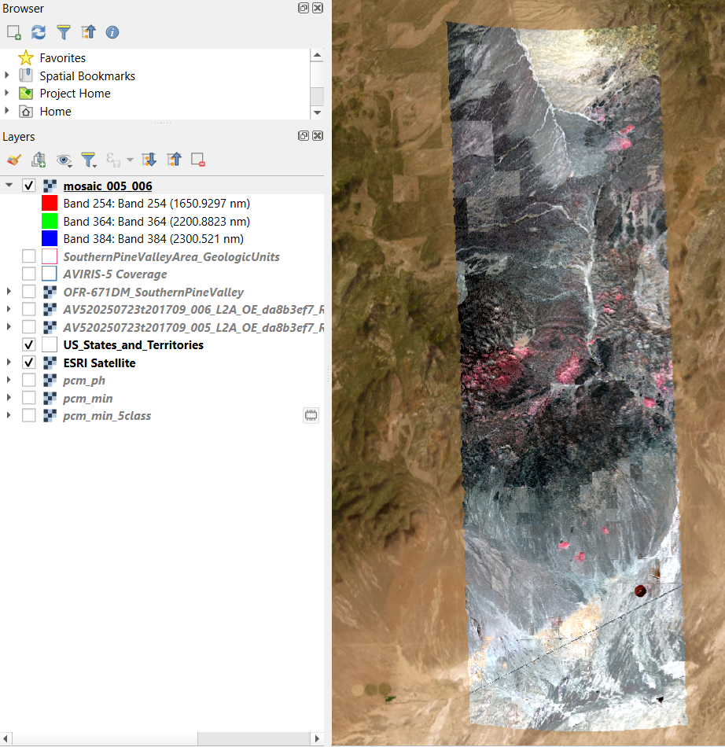

### Spectral Examination

In this false color, alunite will appear as dark magenta/purple, while kaolinite and muscovite will look bright pink or pure red. All tend to be found co-existing within hydrothermal alteration zones. This is because Alunite starts as Muscovite, a potassium-rich mica, which under hydrolysis involving sulfuric acid, loses potassium becoming Kaolinite (Aluminum silicate clay). If the concentration of sulfuric acid in the area remains high, a further reaction produces Alunite. 

#### Alunite Index

One way we can further accentuate these minerals by creating an “Alunite Index” using the ratio of the SWIR band corresponding to 2120 nm (white mica “shoulder”) and that of the SWIR band corresponding to 2160 nm (steep drop area of spectrum following shoulder). The index is calculated as:

**Alunite Index = Band 348 @ 2120 nm / Band 356 @ at 2160 nm**

#### Step 11
Calculate the Alunite Index

**Raster -\> Raster Calculator** for the mosaic vrt, double click on each of these bands to set up the equation in the Raster Calculator expression box. 

Save the result to **alunite_prospect.tif**

- Visualize the image in QGIS, remember to set a standard deviation stretch to increase contrast in **Min / Max Value Settings**.

The image will load as grayscale and you will see the Kaolinite, Muscovite, Alunite areas in bright white in the grayscale raster.

> *Interpretation. Alunite (with or without pyrophyllite) marks the acidic advanced-argillic core of the lithocap; a white-mica halo around it records the transition to less acidic, near-neutral conditions. That acidic to near-neutral zonation is the map-scale fingerprint of the altering system that accompanies the lithophile critical-metal enrichment (Be, Li, Mo, Sn, W, REE, U, F) in these evolved A-type rhyolites.*

## EnMAP Box Plugin

**EnMAP-Box 3** is a powerful, open-source Python plug-in designed for the [QGIS](https://plugins.qgis.org/plugins/enmapboxplugin/) platform. It is specifically built to visualize, process, and analyze multi- and hyperspectral remote sensing data, heavily utilized by researchers dealing with imaging spectroscopy from satellite and airborne missions. Note that currently ENMaP plug-in only works with QGIS 3.x and does not work with QGIS 4.0.

#### Step 12
Start the EnMAP Box Plugin


#### Step 13
We can add a data source that is already opened in QGIS. Lets add the virtual mosaic file of AVIRIS-5 data; mosaic_005_006.

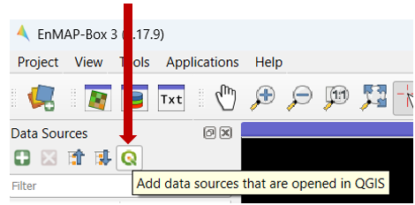

EnMAP Box is able to provide information about the mosaicked AVIRIS-5 netCDF files:

Note the rows x columns is reflective of the mosaic of the two tiles:

- 2.1MB 1453x4279x424x4 (Float32)

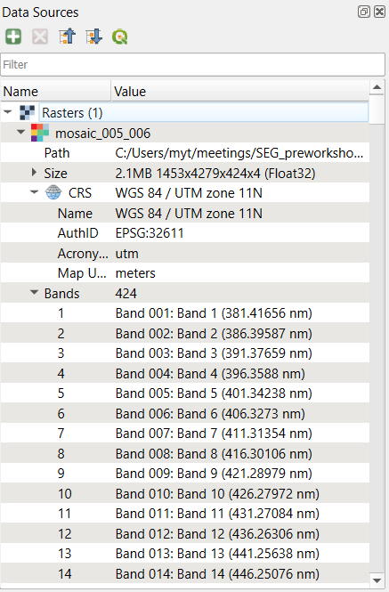

#### Step 14
We can open the virtual_mosaic in an EnMAP Box Viewer:

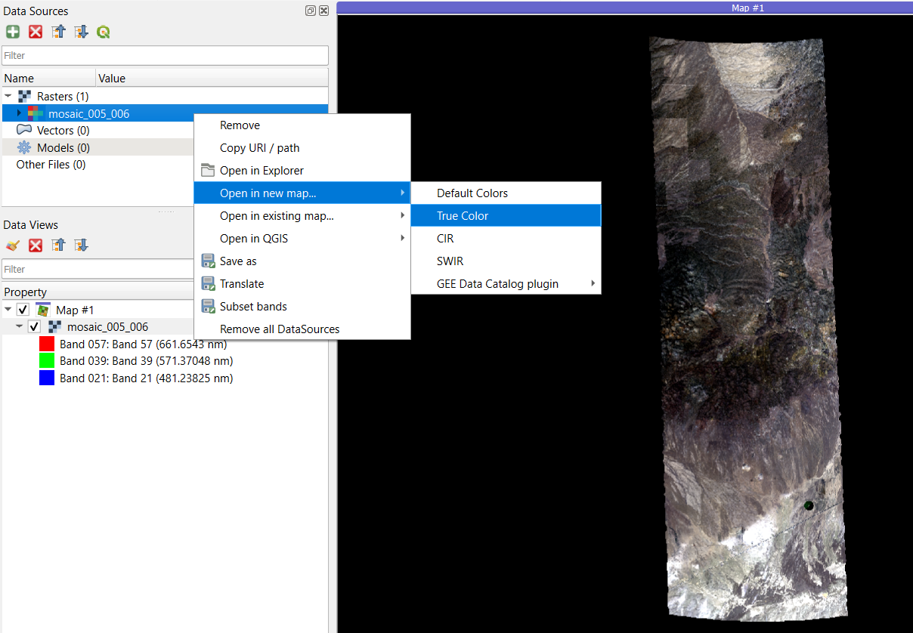

#### Step 15
This time, we’ll use a three-band image to highlight areas of Alunite

Set the mosaic_005_006 r,g,b channels to the following:

**False color: (Highlighting Alunite)**

- Red channel: ~2165 nm (Shortwave Infrared / SWIR) (Band 357)
- Green channel: ~1450 nm (Shortwave Infrared / SWIR ) (Band 214)
- Blue channel: ~1761 nm (Shortwave Infrared / SWIR) (Band 276)

Interpretation: In the SWIR spectrum (~1300 to 2500 nm), alunite displays distinct vibrational overtones from Al-OH and structural hydroxyl groups:

- **2160–2170 nm:** **primary diagnostic absorption feature** for alunite. Heavily used by airborne and spaceborne sensors (like AVIRIS) to map hydrothermal alteration zones.
- **1430–1480 nm:** Alunite displays a characteristic **doublet absorption feature** in this region.
  - *Note:* The exact position of this peak shifts depending on whether it is potassium-rich alunite (~1470 –1480 nm) or sodium-rich natroalunite (~1440 –1490 nm).
- **1760 nm:** A distinct secondary absorption feature useful for distinguishing alunite from other minerals like jarosite.

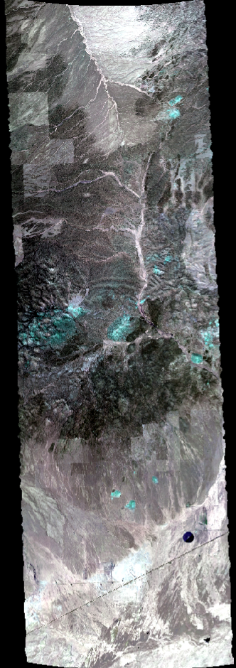

#### EMIT Comparison

We can use an EMIT Mineral Identification and Band Depth Uncertainty dataset file to provide mineral mapping information for our AVIRS-5 data visualizations.

The EMIT Level 2B Estimated Mineral Identification and Band Depth and Uncertainty ([EMIT L2BMIN](https://www.earthdata.nasa.gov/data/catalog/lpcloud-emitl2bmin-001)) is produced by the Tetracorder expert system (USGS), which matches each pixel's continuum-removed reflectance against a library of mineral spectra at a spatial resolution of 60 meters. Each pixel gets up to two identifications:

- Group 1: the ~1 µm (electronic / Fe) region.

- Group 2: the 2.0-2.5 µm region, where the Al-OH sulfates and phyllosilicates (alunite, muscovite, kaolinite, pyrophyllite, dickite) live.

> This categorical indicator map (below) is created from EMIT L2BMIN data where each ROI pixel is colored by the strongest indicator detected (preferring the deeper of its two band-depth identifications).

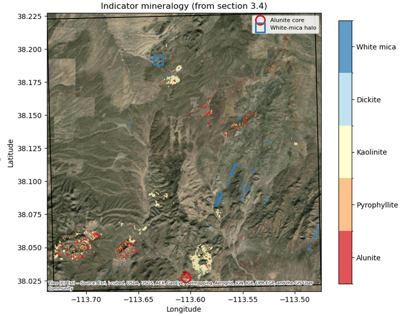

This image is from an EMIT scene near our area of interest.

#### Step 16
Add and display the EMIT **pcm_min_5class.tif** raster file. Note that this tif files has an associated

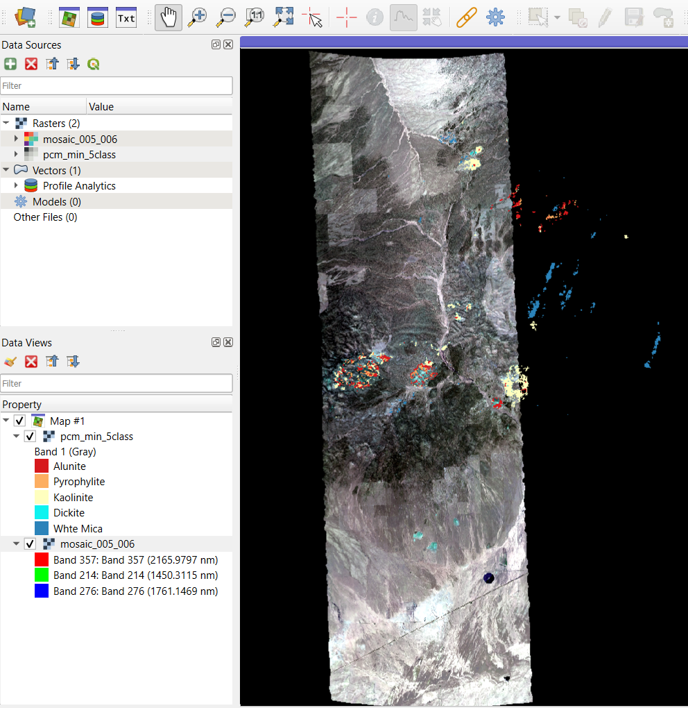

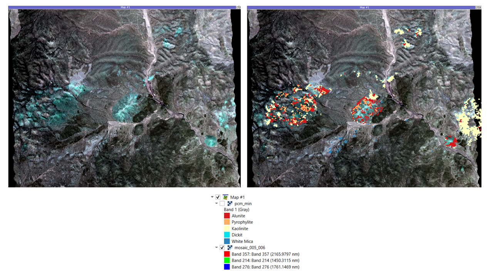

#### Step 17

We can create a Spectral profile in EnMap from pixels of an Alunite region highlighted from this false color Alunite image

1.  Click the blue/green/red stacked discs icon to open up a spectral profile window.

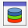

2.  Click the **Spectral Profiler iCon** (the chart icon with a cursor) on the EnMAP-Box toolbar.

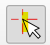

3.  **Open the Spectral Profiler:** First click the box with the squiggly line on the toolbar.

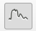

4.  **Collect Profiles of known Aluntie areas:** 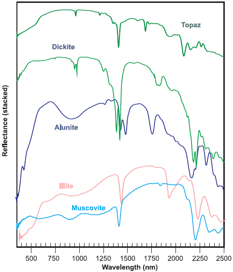

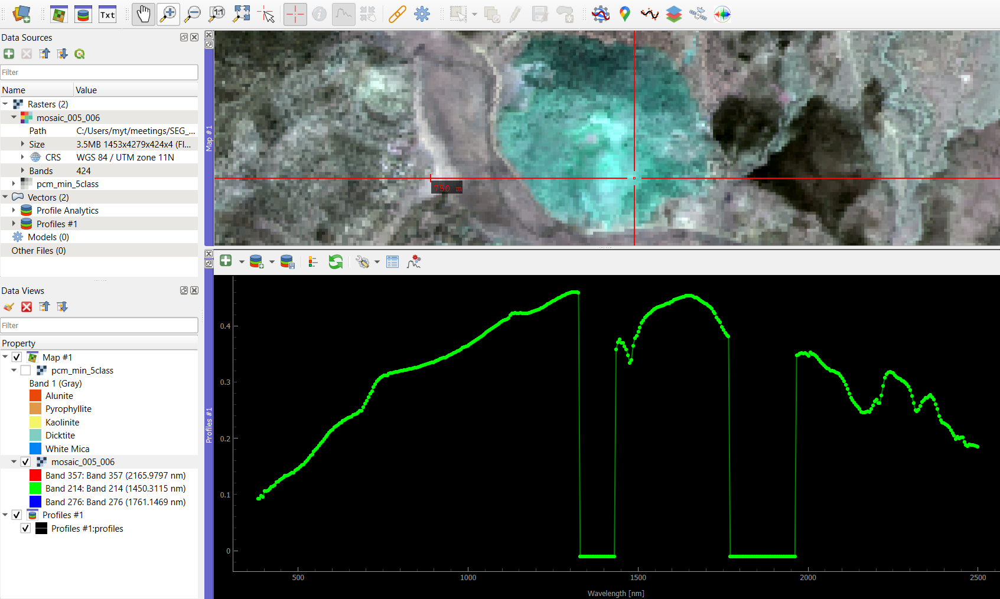

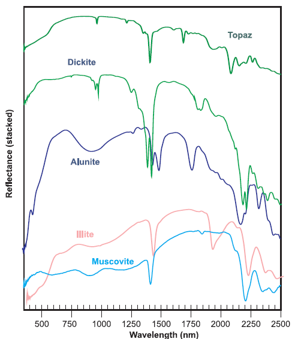

> Interpretation: Alunite curves are characterized by highly distinct **Al-OH absorption features** in the SWIR spectrum, specifically strong dips located at **~1480 nm** and a diagnostic doublet structure near **2165 nm**

Examples of spectra from some common and uncommon minerals. All examples are reference spectra from the Spectral International Inc. (SII) libraries (Kerr et al. 2011)
